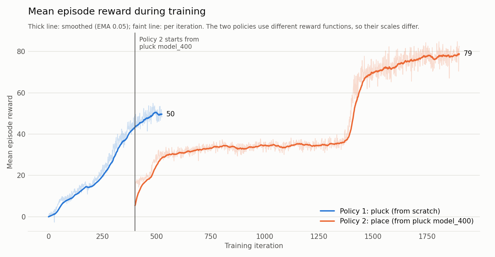
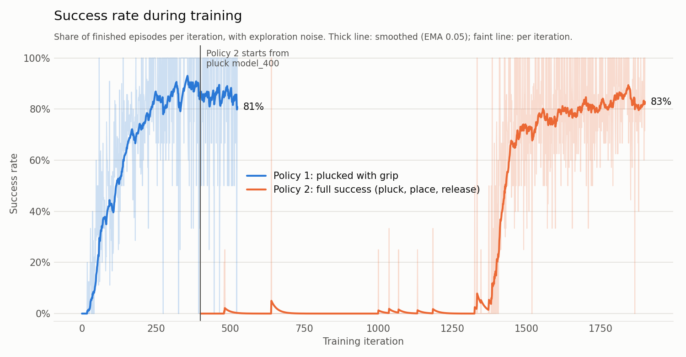

# Humanoid Apple Harvesting with RL

- Unitree G1 humanoid (Dex3 hands) learns to **pluck an apple from a tree and place it in a basket**
- Isaac Sim 6.1 + Isaac Lab 3.0 on Windows, RTX 5060 Ti; PPO (rsl_rl), 1,024 parallel envs
- Environment ported from teammate's `harvest_isaac` (Isaac Lab 2.0 / Linux → 3.0 / Windows)
- OrchardBench tree, **YCB apple** (7.5 cm, 160 g), spring-damper stem that snaps at 12–25 N
- Teammate's success/failure rules ported and **verified identical** against her original code
- **14 controlled joints:** left arm (shoulder, elbow, wrist) + left hand; rest held at home
- **Randomized:** apple position (±8 cm), basket position (±6 cm), arm start pose, stem strength

## Two-policy approach

- **Policy 1, pluck** (from scratch): reach, grasp (all 3 fingers), pluck, hold
  - Reward: distance progress ×10, grasp +5, pluck +10, hold +0.1/step, pull-toward-chest ×10
  - **95.5 % plucked with grip** (200 eval episodes, random apples)
- **Policy 2, place** (fine-tuned from Policy 1): carry to basket, release, place
  - Removed hold + chest reward; added basket progress ×10, release shaping, placed +10, success +50
  - **~80–87 % full success**, ~4 s per pick-and-place

## Key lessons

- Per-step "near/holding" rewards → robot lingers; use progress-only rewards + one-time bonuses
- Total-force pull reward → robot twists apple; reward pulling toward itself
- Fixed apple position → memorized motion; train with randomization from the start
- Releasing was the hardest skill; needed explicit release shaping

## Limitations

- One physical apple on a fixed tree; simulation only
- ~13–20 % of episodes still fail (mostly drops)

## Outputs

- 20 demo videos: `videos/demos/`
- Reward equations: `docs/reward_functions.tex`
- Checkpoints + TensorBoard logs: `IsaacLab3/logs/rsl_rl/harvest_pluck/`, `.../harvest_place/`
